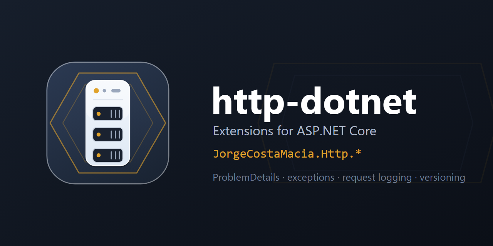

  

# http-dotnet

> Extensions for [ASP.NET Core](https://learn.microsoft.com/aspnet/core/) — request/response base contracts, RFC 7807 ProblemDetails with domain metadata, the exception handler, Serilog request logging, API versioning, OpenAPI and forwarded-headers defaults — each scoped to a single concern and shipped independently under `JorgeCostaMacia.Http.*`.

Part of the `JorgeCostaMacia.*` family, alongside [ddd-dotnet](https://github.com/JorgeCostaMacia/ddd-dotnet) (whose exception hierarchy these handlers map to HTTP), [bus-dotnet](https://github.com/JorgeCostaMacia/bus-dotnet) (messaging), [quartz-dotnet](https://github.com/JorgeCostaMacia/quartz-dotnet) and [serilog-dotnet](https://github.com/JorgeCostaMacia/serilog-dotnet).

An independent project: it builds on ASP.NET Core through its own extension points (extensions on the options and builders the host already writes, middleware and exception handlers) and is not affiliated with Microsoft or the ASP.NET Core project.

## Requirements

The **.NET 10** SDK.

## Packages

| Package | What it does |
| --- | --- |
| [JorgeCostaMacia.Http](https://www.nuget.org/packages/JorgeCostaMacia.Http/) | HTTP request/response base contracts — traceable abstract records. |
| [JorgeCostaMacia.Http.Exception](https://www.nuget.org/packages/JorgeCostaMacia.Http.Exception/) | Maps domain / validation / bad-request exceptions to HTTP status codes. |
| [JorgeCostaMacia.Http.Exception.Serilog](https://www.nuget.org/packages/JorgeCostaMacia.Http.Exception.Serilog/) | Serilog logging of unhandled exceptions, enriched with aggregate metadata. |
| [JorgeCostaMacia.Http.ForwardedHeaders](https://www.nuget.org/packages/JorgeCostaMacia.Http.ForwardedHeaders/) | Forwarded-headers defaults for a service behind a proxy on the same host or Docker's bridge. |
| [JorgeCostaMacia.Http.MinimalApi.Versioning](https://www.nuget.org/packages/JorgeCostaMacia.Http.MinimalApi.Versioning/) | URL-segment API versioning for Minimal APIs. |
| [JorgeCostaMacia.Http.OpenApi](https://www.nuget.org/packages/JorgeCostaMacia.Http.OpenApi/) | Native OpenAPI setup with RFC 7807 ProblemDetails schema enrichment. |
| [JorgeCostaMacia.Http.ProblemDetails](https://www.nuget.org/packages/JorgeCostaMacia.Http.ProblemDetails/) | Enriched RFC 7807 ProblemDetails responses with domain metadata and per-field errors. |
| [JorgeCostaMacia.Http.Serilog](https://www.nuget.org/packages/JorgeCostaMacia.Http.Serilog/) | Serilog request-logging middleware: body buffering, enrichment and a per-request summary. |

## Upgrading

What each version asks of you, when it asks anything, is in [CHANGELOG.md](CHANGELOG.md).

## Contact

- [LinkedIn](https://www.linkedin.com/in/jorge-costa-macia-842817164/)
- [GitHub](https://github.com/JorgeCostaMacia/)
- [Bitbucket](https://bitbucket.org/jorgecostamacia/)
